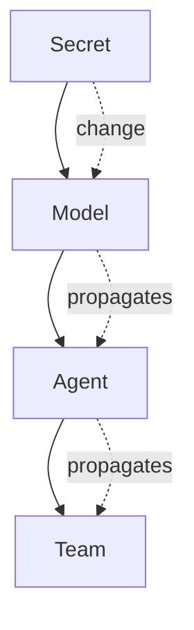

Reactive dependencies enable automatic change propagation through your infrastructure. When a resource changes, Pragmatiks identifies all dependent resources and updates them automatically.



## Field References

Use field references to connect a resource's config field to another resource's output. When the referenced resource updates, the dependent resource automatically receives the new value.

```yaml
# Secret holds the API key
provider: pragmatiks/pragma
resource: secret
name: anthropic-key
config:
  data:
    api_key: "sk-ant-..."
---
# Model references the secret's output
provider: pragmatiks/agno
resource: models/anthropic
name: claude
config:
  model_id: claude-sonnet-4-5-20250929
  api_key:
    provider: pragmatiks/pragma
    resource: secret
    name: anthropic-key
    field: outputs.api_key
```

The `api_key` field is a **FieldReference** — a structured pointer to another resource's output. The format is:

| Key | Description | Example |
|-----|-------------|---------|
| `provider` | Provider of the referenced resource | `pragma` |
| `resource` | Resource type | `secret` |
| `name` | Resource name | `anthropic-key` |
| `field` | Output field path (must start with `outputs.`) | `outputs.api_key` |

When `anthropic-key` updates, Pragmatiks re-resolves the field reference and sends the new value to the `claude` model's provider.

## Dependency[T] Pattern

For provider authors, `Dependency[T]` declares a whole-resource dependency. Instead of referencing a single output field, the provider receives the entire resolved resource — its config, outputs, and metadata.

```yaml
# Agent depends on a model resource
provider: pragmatiks/agno
resource: agent
name: my-agent
config:
  model:
    provider: pragmatiks/agno
    resource: models/anthropic
    name: claude
  instructions: "You are a helpful assistant."
```

In the provider code, this is declared as:

```python
from pragma_sdk import Config, Dependency

class AgentConfig(Config):
    model: Dependency[AnthropicModel]
    instructions: str
```

When the `claude` model resource updates, Pragmatiks re-resolves the dependency and sends the updated model data to the agent's provider. The provider then decides how to handle the change (e.g., rebuild the agent with the new model).

<Note>
**FieldReference vs Dependency[T]**: Use a FieldReference when you need a single value from another resource (like a connection URL or API key). Use `Dependency[T]` when the provider needs the full resource context to operate.
</Note>

## Applying Before Dependencies Are Ready

A dependency must exist before you apply a resource that references it; an apply that references a resource that does not exist, or was deleted, is refused. The dependency does not have to be ready. If it is not, Pragmatiks stores the dependent in `waiting` state and processes it automatically once all its dependencies are ready. While it waits, `pragma resources describe` lists each dependency it is waiting for under `Blocked by:`.

```bash
# Apply the model first — it starts provisioning
pragma resources apply model.yaml

# Apply the agent right away — it waits until the model is ready, then processes automatically
pragma resources apply agent.yaml
```

This means you can define an entire stack in a single YAML file and apply it at once. `pragma resources apply` applies the documents in file order, so list each dependency before the resources that reference it:

```yaml
provider: pragmatiks/pragma
resource: secret
name: api-key
config:
  data:
    api_key: "sk-ant-..."
---
provider: pragmatiks/agno
resource: models/anthropic
name: claude
config:
  model_id: claude-sonnet-4-5-20250929
  api_key:
    provider: pragmatiks/pragma
    resource: secret
    name: api-key
    field: outputs.api_key
---
provider: pragmatiks/agno
resource: agent
name: assistant
config:
  model:
    provider: pragmatiks/agno
    resource: models/anthropic
    name: claude
  instructions: "You are a helpful assistant."
```

Pragmatiks then processes each resource as soon as its dependencies are ready.

## Change Propagation

Pragmatiks computes what each dependent needs from the state of the resources it depends on, every time one of them changes:

1. **Ready dependents** — When a dependency reaches `ready` and every other dependency of the dependent is `ready` too, Pragmatiks resolves the dependent's config again. If the result differs, the dependent is sent back to its provider for an update; if it is the same, nothing runs. While any of its dependencies is not ready, a ready dependent keeps its current configuration.
2. **Waiting dependents** — Once every dependency is ready, the dependent is resolved and submitted to its provider.
3. **Processing dependents** — The running operation is not interrupted. When it ends, Pragmatiks resolves the config again; if a dependency's outputs changed meanwhile, the dependent runs once more with the new values.
4. **Dependents of a failed dependency** — A ready dependent stays `ready` with health `degraded`; `degraded_by` names the failed dependency. Once the dependency is ready again, the dependent is resolved again as above. A waiting dependent keeps waiting.
5. **Dependents of a deactivated dependency** — Move to `waiting` without a call to their provider, and recover by themselves once the dependency is applied again and ready.
6. **Dependents of a deleted dependency** — Move to `failed` with the error `Dependency <id> was deleted. Apply again to retry it, or deactivate the resource to discard it.`

A dependent whose references can no longer be resolved, for example because a dependency no longer outputs the referenced field, moves to `failed` with an error that says which reference could not be resolved.

This propagation is recursive: if updating resource B causes it to reach `ready`, Pragmatiks then checks B's dependents and propagates further.

## Resolved Config

When a resource transitions to `pending` state with all dependencies ready, Pragmatiks creates a `resolved_config` — a copy of the config where all FieldReferences and Dependency markers have been replaced with actual values. This is what gets sent to the provider.

You can inspect the resolved config to debug dependency resolution:

```bash
pragma resources describe pragmatiks/agno/agent/my-agent -o json
```

The response includes both `config` (your original declaration with references) and `resolved_config` (the fully resolved version sent to the provider).

## Dependency Rules

**Circular dependencies are not allowed.** If A depends on B, B cannot depend on A — this prevents infinite update loops.

**Changes cascade downward.** When a resource updates, all resources that depend on it are notified and can react to the change.

**Deactivation sets dependents to waiting; deletion fails them.** Dependents are never torn down with the resource they depend on. Deactivating a resource moves its dependents to `waiting` until it is applied again; deleting it moves them to `failed`. Run the command with `--dry-run` to list them first. See [Deletion Behavior](/concepts/resources#deletion-behavior) for details.

## Next Steps

<CardGroup cols={2}>
  <Card title="Resources" icon="cube" href="/concepts/resources">
    Understand resource lifecycle and states.
  </Card>
  <Card title="Reactive Pipelines Guide" icon="diagram-project" href="/guides/reactive-pipelines">
    Build multi-resource pipelines with automatic change propagation.
  </Card>
</CardGroup>
