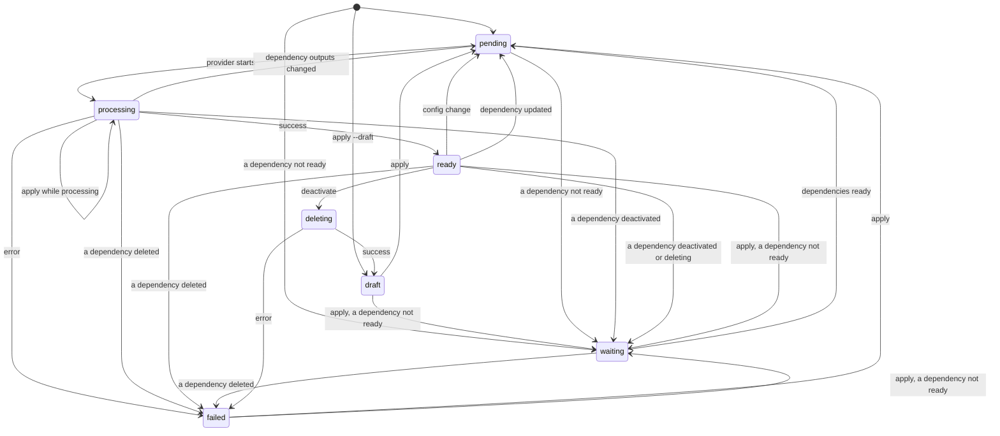

Resources are the infrastructure components that Pragmatiks manages: storage buckets, AI models, secrets, agents, and more. You declare resources in YAML, and Pragmatiks handles provisioning, state tracking, and lifecycle management.

## Resource Structure

Every resource has a consistent structure:

| Field | Description | Example |
|-------|-------------|---------|
| `provider` | The provider that manages this resource | `agno` |
| `resource` | The type of resource | `agent` |
| `name` | A unique identifier you assign | `my-assistant` |
| `config` | Your settings for this resource | `model_id: claude-sonnet-4-5-20250929` |
| `tags` | Optional metadata labels | `["env:prod", "team:ml"]` |
| `depends_on` | Explicit dependencies (optional) | Other resources |
| `outputs` | What it exposes to other resources (set by provider) | URLs, IDs, secrets |

## Configuration Example

Here's an Agno AI model resource:

```yaml
provider: pragmatiks/agno
resource: models/anthropic
name: claude
config:
  model_id: claude-sonnet-4-5-20250929
  api_key:
    provider: pragmatiks/pragma
    resource: secret
    name: anthropic-key
    field: outputs.api_key
tags:
  - env:production
  - team:ai
```

After provisioning, the resource exposes outputs that other resources can reference:

```yaml
# After provisioning, outputs become available:
# outputs:
#   model_name: "claude-sonnet-4-5-20250929"
#   provider_type: "anthropic"
```

## Resource Lifecycle

Resources move through these states as pragma manages them:



| State | Description |
|-------|-------------|
| `draft` | Created but not queued for processing (use the `--draft` flag on a new or draft resource, or deactivate a live one) |
| `waiting` | Applied, but a resource it depends on is not ready, or is being deactivated or is in draft. It moves on by itself once its dependencies are ready. `pragma resources describe` names each dependency it is waiting for. |
| `pending` | Queued for the provider to handle |
| `processing` | Currently being handled by the provider. An operation has 20 minutes to finish before the resource moves to `failed`. |
| `deleting` | A deactivate or delete is running: the provider is removing the resource. A deactivated resource returns to `draft` when it finishes. |
| `ready` | Successfully provisioned and operational |
| `failed` | The last operation failed, or a resource it depends on was deleted. The `error` field says why. |
| `deleted` | Deleted. The resource no longer appears in the project. |

<Note>
Applying a new configuration to a `processing` resource does not interrupt the running operation. The resource stays `processing` and keeps the new configuration in its `queued_config` field; it is applied as soon as the running operation ends. `pragma resources describe` and `pragma resources list` show such a resource as `processing (apply queued)`.
</Note>

<Note>
A resource in `waiting` state keeps its last resolved configuration in `resolved_config`; a resource that has never been processed has none. Once all dependencies are ready, Pragmatiks resolves the config again and submits the resource for processing.
</Note>

## Health

Every resource read carries a `health` value that Pragmatiks computes from the resource's state and its dependencies:

| Health | Meaning |
|--------|---------|
| `blocked` | The resource is waiting for a dependency or a resource it owns. `blockers` names each one. It is also `blocked` while the resource's provider changes version; `provider_blocker` then names the provider. |
| `failed` | The resource is in `failed` state. |
| `degraded` | The resource is `ready`, but a resource it depends on failed its last operation. `degraded_by` names each one. |
| `healthy` | None of the above. |

Each entry in `blockers` and `degraded_by` names the resource, the reason, and the command that shows that resource:

```json
{
  "health": "blocked",
  "blockers": [
    {
      "project": "my-project",
      "resource": "pragmatiks/pragma/secret/api-key",
      "reason": "Waiting for pragmatiks/pragma/secret/api-key to be ready.",
      "command": "pragma --project my-project resources describe pragmatiks/pragma/secret/api-key"
    }
  ],
  "degraded_by": []
}
```

A `degraded_by` entry reads `Dependency <id> failed its last operation.` A degraded resource stays `ready` with its last configuration. Once the failed dependency is ready again, Pragmatiks resolves the resource's config again and updates it if the result changed.

## Config vs Resolved Config

Each resource has two config representations:

- **`config`** — Your original declaration, including FieldReferences and Dependency markers as-is
- **`resolved_config`** — The fully resolved version where all references have been replaced with actual values from dependency outputs

The `resolved_config` is what gets sent to the provider. You can inspect both to debug dependency resolution:

```bash
pragma resources describe pragmatiks/agno/agent/my-agent -o json
```

## Idempotent Apply

Re-applying a resource with identical configuration is a no-op. If the resource is already `ready` and the normalized config matches, Pragmatiks returns the existing resource without re-processing. This makes it safe to run `pragma resources apply` repeatedly in scripts and CI/CD pipelines.

## Deletion Behavior

When you delete a resource, Pragmatiks handles its relationships:

### Dependents Wait or Fail

Resources that **depend on** a resource you deactivate or delete are not torn down with it:

- **Deactivate:** each dependent moves to `waiting`, without a call to its provider. It keeps running as it is and recovers by itself once the dependency is applied again and ready.
- **Delete:** each dependent waits while the delete runs, then moves to `failed` once the resource is deleted, with the error `Dependency <id> was deleted. Apply again to retry it, or deactivate the resource to discard it.` A dependent that is processing when the dependency is deleted fails once its operation ends.

```text
# Before:
secret (READY) ← model (READY) ← agent (READY)

# After deactivating secret:
secret (DRAFT) ← model (WAITING) ← agent (READY)

# After deleting secret:
model (FAILED: Dependency <secret id> was deleted. ...) ← agent (READY, health degraded)
```

Run the command with `--dry-run` to see what it would do first. Each dependent is listed as `moved to waiting until its dependency returns` for a deactivate, or `failed, its dependency is deleted` for a delete:

```bash
pragma resources delete --dry-run pragmatiks/pragma/secret/api-key
```

### Cascade Delete (Owned Resources)

A provider can create resources that its own resource owns. Deleting the owner deletes everything it owns, and an owned resource is deleted before its owner. Owned resources have no meaning without their owner. You do not declare ownership in YAML: the owner's provider sets it when it creates the resource.

## Resource Tags

Tags are key-value labels for organizing and filtering resources:

```yaml
provider: pragmatiks/agno
resource: agent
name: my-agent
config:
  instructions: "..."
tags:
  - env:production
  - team:ai
  - cost-center:123
```

Filter resources by tag:

```bash
pragma resources list --tag env:production
```

Manage tags on existing resources:

```bash
pragma resources tags add pragmatiks/agno/agent/my-agent --tag env:staging
pragma resources tags remove pragmatiks/agno/agent/my-agent --tag env:production
```

## Applying Resources

Create and provision resources immediately:

```bash
pragma resources apply warehouse.yaml
```

Create resources in draft state (skip provisioning):

```bash
pragma resources apply --draft warehouse.yaml
```

## Next Steps

<CardGroup cols={2}>
  <Card title="Reactive Dependencies" icon="diagram-project" href="/concepts/reactive-dependencies">
    Automatic change propagation through dependencies.
  </Card>
  <Card title="CLI Resources" icon="terminal" href="/cli/resources">
    Resource management commands.
  </Card>
</CardGroup>
